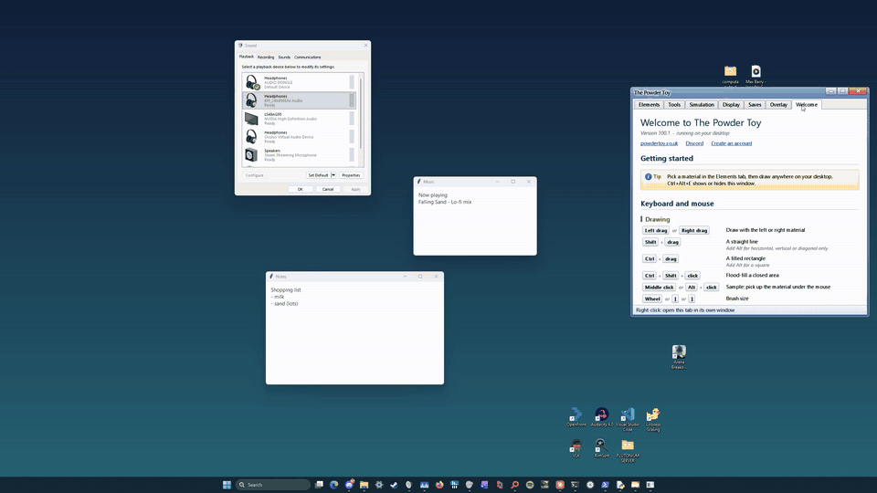
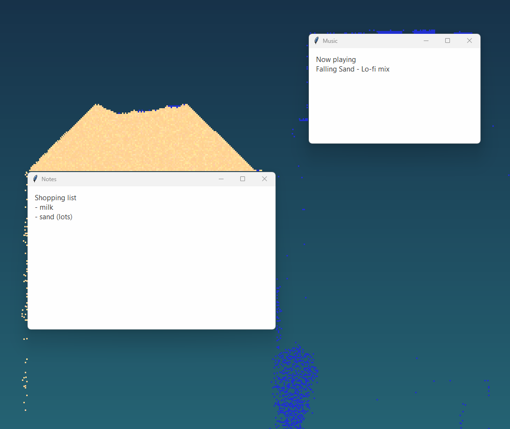
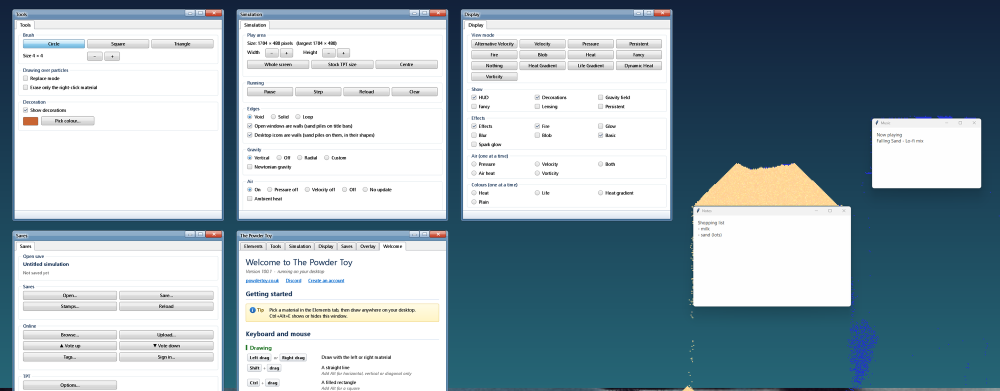
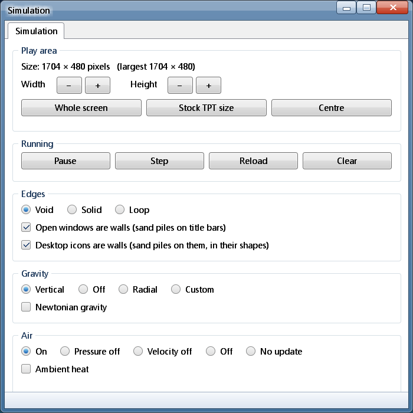
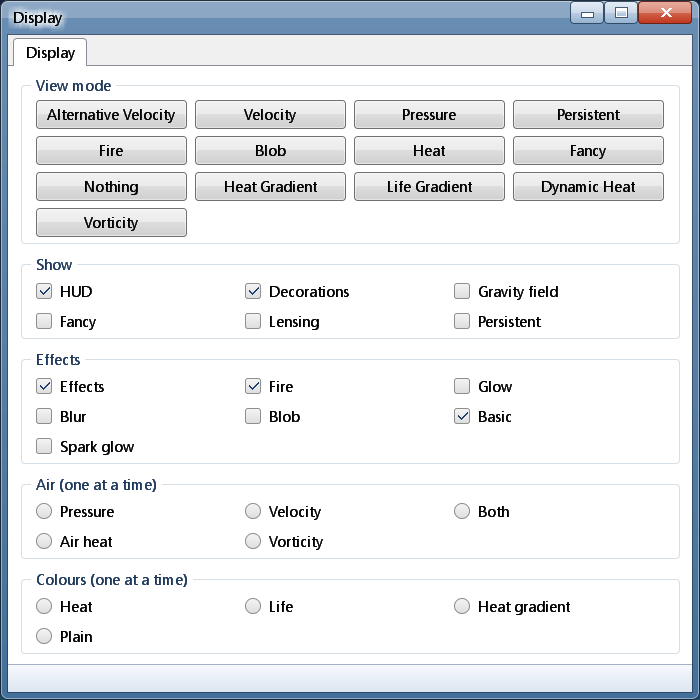

The Desktop Powder Toy
======================

A fork of [The Powder Toy](https://github.com/The-Powder-Toy/The-Powder-Toy) that runs the simulation **on your
Windows desktop**: sand piles up on your open windows and desktop icons, water pours off title bars, and
everything you don't draw stays see-through and clickable. All of the original game is still here; the original
README follows below.

**[Download](https://github.com/PVCPC/The-Desktop-Powder-Toy/releases/latest)** for Windows 10/11 or macOS 11+ (Apple
Silicon): unzip and run it, nothing to install.

Our work is on the [`overlay`](https://github.com/PVCPC/The-Desktop-Powder-Toy/tree/overlay) branch. Details, design notes and the to-do list are in
[OVERLAY.md](https://github.com/PVCPC/The-Desktop-Powder-Toy/blob/overlay/OVERLAY.md).

What's new
----------

- **Desktop overlay** (the default; `overlay:off` gives the normal window): a borderless window over the whole screen. Empty pixels are
  see-through, and clicks on them go to whatever is behind.
- **Windows and icons are walls.** Every open window is solid to particles, pixel-exact, and moving one shoves
  the sand around: drag a window and its pile rides along with it. Desktop icons are walls in their real shapes, so
  sand drapes over them.
- **Three layers**: over everything, under app windows (over the wallpaper), or behind the desktop icons like a
  live wallpaper.
- **Input modes** for where clicks go: Auto (TPT while it's in front, the desktop otherwise), Pass-through and
  Locked, with global hotkeys (Ctrl+Alt+O / P / L, customisable). Full-screen apps and games are detected and the
  overlay steps aside. Ctrl+Alt+C clears the screen.
- **Windows you can throw sand with**: sand rides a window you drag and flies off when you stop or shake it; a tall
  pile shears (the bottom grips the window, the layers above slip and slide off) and liquids slosh;
  fire and lava scorch windows, ice frosts them, acid pits them and water streaks them; desktop icons carry their
  pile when you drop them; your mouse blows sand like a breeze. Sliders in the Simulation tab tune all of it.
- **Destructible windows** (a switch, off by default): acid eats holes in windows and icons, explosions blow chunks
  out that fly off in the window's colour, DEST and black holes chew through, and you see what's really behind
  through the holes. Explosions can even shake your real windows (its own slider, off by default). Only the overlay
  is broken: clearing the sim mends everything.
- **Fun switches** (Simulation window, all off by default): stick figure pets that wander your windows and
  taskbar; snow, rain with lightning, or leaves by the season; pets run from fire; the Recycle Bin eats sand that lands on it; sand hops to the beat
  of whatever your PC plays; the mouse pointer as a broom; closing a window throws its pile off; new windows; busy apps warm what sits on their windows, so snow melts on a working game but stays on an idle
  app; new windows
  shake sand loose.
- **New elements** (Special menu): BIRD flies in flocks; FISH swim in schools in any liquid; BALL makes one round
  ball per brush click, the brush's size, that bounces, rolls and knocks other balls; JOIN holds what you paint in
  one stroke together, so a line from a metal post hangs like a rope, a line between two posts sags like a bridge
  and a blob wobbles like jelly. With BALL or JOIN selected, press on a ball or jelly to pick it up, and let go
  while moving to throw it.
- **Your sand stays**: the scene is saved when you quit and comes back next time.
- **Light on the CPU**: when nothing moves it drops to a few frames a second (about a quarter of one core).
- **Uses every core**: plain particles (sand, water and the like) update and are drawn across all CPU cores, and so
  does the air, so
  big piles stay smooth (about 53 ticks a second with 190k falling grains, from 30).
- **Desktop-style menus**: TPT's side bar and tool strip move into real Windows windows (Elements, Simulation,
  Display, Saves, Overlay tabs) that can be dragged, docked, torn into separate windows and hidden to the tray
  icon. Dragging one doesn't freeze the simulation.
- **Big, resizable sim**: the sim fills the screen (422x110 cells at 3x on a 5120x1440 display), with a
  play area you can resize at run time. Saves made at stock size still open in normal TPT.
- **Smooth and low latency**: frames go to the GPU (Direct3D 11 + DirectComposition) and are drawn at the
  screen's refresh rate (120 Hz+) while the physics stays at 60. Moving grains are carried forward between
  physics steps, so there's no added frame of lag, and sand stays on a moving window.
- `overlay:window` runs TPT in its normal window but with the new side windows and tray. Resize the window for more
  or less room (up to the size of the screen).
- **Every monitor**: the overlay spans all your screens; sand stops at the edge of a shorter one. On a first run the
  sim pixel size follows the screen and Windows' display scaling (2x on a 1080p screen at 100%, 3x at 150%).

| Simulation | Display |
|---|---|
|  |  |

Windows and macOS. Download it above, or build as below and run `powder.exe` (`powder` on the Mac). The Mac version
is newer and smaller: the sim and window walls are the same, but TPT's own menus stand in for the side window, and an
hourglass in the menu bar for the tray icon (click modes, pause, clear, quit).

---

The Powder Toy - June 2026
==========================

Get the latest version [from the Powder Toy website](https://powdertoy.co.uk/Download.html). We're also on [Steam](https://store.steampowered.com/app/1148350/The_Powder_Toy/).

To use online features such as saving, you need to [register an account](https://powdertoy.co.uk/Register.html).
You can also visit [the official TPT forum](https://powdertoy.co.uk/Discussions/Categories/Index.html).

Have you ever wanted to blow something up? Or maybe you always dreamt of operating an atomic power plant? Do you have a will to develop your own CPU? The Powder Toy lets you to do all of these, and even more!

The Powder Toy is a free physics sandbox game, which simulates air pressure and velocity, heat, gravity and a countless number of interactions between different substances! The game provides you with various building materials, liquids, gases and electronic components which can be used to construct complex machines, guns, bombs, realistic terrains and almost anything else. You can then mine them and watch cool explosions, add intricate wirings, play with little stickmen or operate your machine. You can browse and play thousands of different saves made by the community or upload your own – we welcome your creations!

There is a Lua API – you can automate your work or even make plugins for the game. The Powder Toy is free and the source code is distributed under the GNU General Public License, so you can modify the game yourself or help with development.

Build instructions
===========================================================================

See the _Powder Toy Development Help_ section [on the main page of the wiki](https://powdertoy.co.uk/Wiki/W/Main_Page.html).

Special Thanks
===========================================================================

* Stanislaw K Skowronek - Designed the original Powder Toy
* Simon Robertshaw - Wrote the website, current server owner
* Skresanov Savely
* Pilihp64
* Catelite
* Victoria Hoyle
* Nathan Cousins
* jacksonmj
* Felix Wallin
* Lieuwe Mosch
* Anthony Boot
* Me4502
* MaksProg
* jacob1
* mniip
* LBPHacker

Libraries and other assets used
===========================================================================

* [bzip2](http://www.bzip.org/)
* [FFTW](http://fftw.org/)
* [JsonCpp](https://github.com/open-source-parsers/jsoncpp)
* [libcurl](https://curl.se/libcurl/)
* [libpng](http://www.libpng.org/pub/png/libpng.html)
* [Lua](https://www.lua.org/)
* [LuaJIT](https://luajit.org/)
* [Mallangche](https://github.com/JammPark/Mallangche)
* [mbedtls](https://www.trustedfirmware.org/projects/mbed-tls/)
* [SDL](https://libsdl.org/)

Instructions
===========================================================================

Click on the elements with the mouse and draw in the field, like in MS Paint. The rest of the game is learning what happens next.

Controls
===========================================================================

| Key                     | Action                                                          |
| ----------------------- | --------------------------------------------------------------- |
| TAB                     | Switch between circle/square/triangle brush                     |
| Space                   | Pause                                                           |
| Q / Esc                 | Quit                                                            |
| Z                       | Zoom                                                            |
| S                       | Save stamp (use with Ctrl when STK2 is out)                     |
| L                       | Load last saved stamp                                           |
| K                       | Stamp library                                                   |
| 0-9                     | Set view mode                                                   |
| P / F2                  | Save screenshot as .png                                         |
| E                       | Bring up element search                                         |
| F                       | Pause and step to next frame                                    |
| G                       | Increase grid size                                              |
| Shift + G               | Decrease grid size                                              |
| H                       | Show/Hide HUD                                                   |
| Ctrl + H / F1           | Show intro text                                                 |
| D / F3                  | Debug mode (use with Ctrl when STK2 is out)                     |
| I                       | Invert Pressure and Velocity map                                |
| W                       | Cycle gravity modes (use with Ctrl when STK2 is out)            |
| Y                       | Cycle air modes                                                 |
| Ctrl + E                | Cycle edge modes                                                |
| B                       | Enter decoration editor menu                                    |
| Ctrl + B                | Toggle decorations on/off                                       |
| N                       | Toggle Newtonian Gravity on/off                                 |
| U                       | Toggle ambient heat on/off                                      |
| Ctrl + I                | Install powder toy, for loading saves/stamps by double clicking |
| Backtick                | Toggle console                                                  |
| =                       | Reset pressure and velocity map                                 |
| Ctrl + =                | Reset Electricity                                               |
| \[                      | Decrease brush size                                             |
| \]                      | Increase brush size                                             |
| Alt + \[                | Decrease brush size by 1                                        |
| Alt + \]                | Increase brush size by 1                                        |
| Ctrl + C/V/X            | Copy/Paste/Cut                                                  |
| Ctrl + Z                | Undo                                                            |
| Ctrl + Y                | Redo                                                            |
| Ctrl + Cursor drag      | Rectangle                                                       |
| Shift + Cursor drag     | Line                                                            |
| Middle click            | Sample element                                                  |
| Alt + Left click        | Sample element                                                  |
| Mouse scroll            | Change brush size                                               |
| Ctrl + Mouse scroll     | Change vertical brush size                                      |
| Shift + Mouse scroll    | Change horizontal brush size                                    |
| Shift + R               | Horizontal mirror for selected area when pasting stamps         |
| Ctrl + Shift + R        | Vertical mirror for selected area when pasting stamps           |
| R                       | Rotate selected area counterclockwise when pasting stamps       |
| F11                     | Toggle fullscreen                                               |

Command Line
---------------------------------------------------------------------------

| Command               | Description                                      | Example                                     |
| --------------------- | ------------------------------------------------ | --------------------------------------------|
| `scale:SIZE`          | Change window scale factor                       | `scale:2`                                   |
| `kiosk`               | Fullscreen mode                                  |                                             |
| `proxy:SERVER[:PORT]` | Proxy server to use                              | `proxy:wwwcache.lancs.ac.uk:8080`           |
| `open FILE`           | Opens the file as a stamp or game save           |                                             |
| `ddir DIRECTORY`      | Directory used for saving stamps and preferences |                                             |
| `ptsave:SAVEID`       | Open online save, used by ptsave: URLs           | `ptsave:2198`                               |
| `disable-network`     | Disables internet connections                    |                                             |
| `disable-bluescreen`  | Disable bluescreen handler                       |                                             |
| `redirect`            | Redirects output to stdout.txt / stderr.txt      |                                             |
| `console`             | Redirects output to a new console on Windows     |                                             |
| `cafile:CAFILE`       | Set certificate bundle path                      | `cafile:/etc/ssl/certs/ca-certificates.crt` |
| `capath:CAPATH`       | Set certificate directory path                   | `capath:/etc/ssl/certs`                     |
